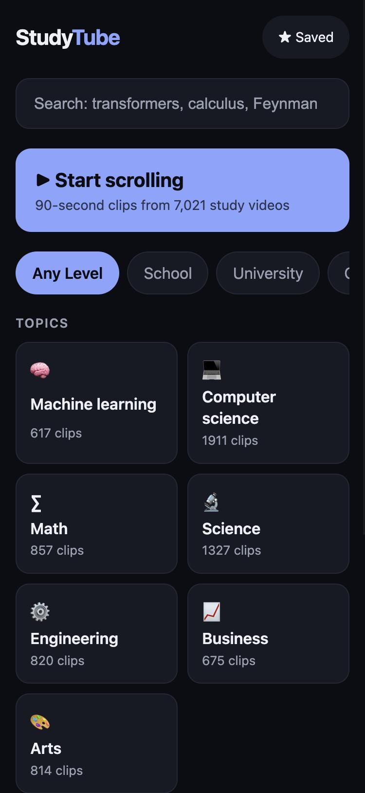
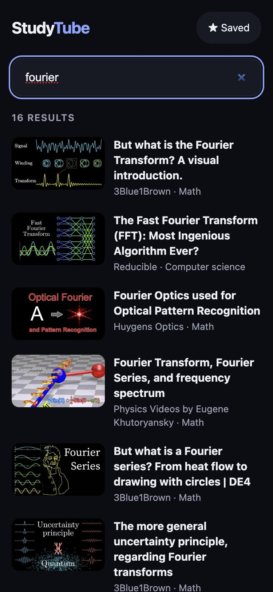
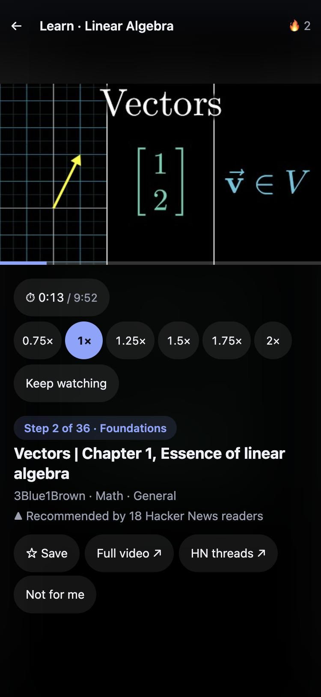

# StudyTube

**TikTok-style scrolling for studying.** 90-second clips from 7,000+ lectures and explainers, picked from what Hacker News readers keep recommending. Free, no login.

**Live: https://studytube-36f.pages.dev**

[](https://github.com/Lameda12/studytube/actions/workflows/ci.yml)
[](LICENSE)

<p>
  
  
  
</p>

Inspired by [Karpathy's HackerTube](https://hackertube.org): the same idea (let years of Hacker News recommendations filter the noise), pointed at learning instead of watching.

## What it does

- **Search → tap → keep scrolling.** Live search over 7,021 videos from 1,261 channels.
- **90-second clips.** Auto-advance when a clip ends. "Keep watching" removes the limit.
- **28 Learn tracks** (linear algebra, neural networks, algorithms, quantum, economics, …) ordered beginner → advanced. A track opens at the first step you haven't watched.
- **Speed 0.75×–2×** and **jump to any timecode** (`12:34`, `1:02:03`, `754`). Arrow keys seek 5s.
- **Full-screen / landscape.** An Expand button, plus automatic landscape layout when a touch phone is rotated. iPhone Safari can't lock orientation, so the video is rotated with CSS there.
- **No accounts, no tracking.** Saves, watched list and settings live in your browser (`localStorage`).
- Works on phones, tablets and desktop. Keyboard: `↑↓`/`J K` next, `Space` pause, `M` sound, `S` save, `< >` speed, `F` expand.

## How the videos are chosen

1. **Mine Hacker News.** The public HN dump (32M comments up to Aug 2023, via the ClickHouse playground) is scanned for YouTube links. A video counts once per distinct HN user who linked it; ≥3 recommenders keeps it (15,052 videos).
2. **Filter.** Embeddable, not live, 3–120 min, English, study-topic keywords, not music/entertainment categories.
3. **Add ~120 hand-picked channels** (`data/seed-channels.json`) for what HN under-recommends: school-level math and science, business, arts.
4. **Pick the clip start.** Priority: a moment HN commenters linked (`?t=`) → YouTube's "most replayed" peak → first real chapter → a guess.
5. **Rank.** One 0–100 quality score (HN recommenders 55%, views 15%, like ratio 10%, hand-picked channel 10%, start evidence bonus) with a per-channel decay, then at runtime: watched videos sink, saved channels rise, no channel back-to-back.

## Run it

```bash
npm install
npm run dev        # http://localhost:3000, uses the committed catalog
npm run check      # typecheck + tests + production build
```

The app is a fully static Next.js export (`output: "export"`), so `npm run build` produces `out/`, deployable to Cloudflare Pages, Netlify, GitHub Pages or any CDN.

### Rebuild the catalog

The app reads `public/catalog.json` and `public/tracks.json`. To regenerate them (needs a [YouTube Data API key](.env.example), free quota):

```bash
cp .env.example .env.local   # add YOUTUBE_API_KEY
npm run mine           # HN comments -> data/mined.json
npm run curate         # oEmbed check + topic keywords -> data/candidates.json
npm run ingest:seeds   # seed channels' uploads (also fills the YouTube cache)
npm run enrich         # YouTube metadata for every candidate
npm run mine:times     # moments HN readers linked
npm run heat           # "most replayed" peaks via yt-dlp (slow on purpose; see below)
npm run build:data     # merge + rank -> public/catalog.json, videos.json, tracks.json
```

`data/yt-cache.json` (≈70 MB) is not committed; `ingest:seeds` and `enrich` recreate it.
To drop a video, add its id to `data/block.json`.

> **Heatmap fetch is deliberately slow.** `npm run heat` reads metadata with `yt-dlp` at ~1 request / 6 s and stops after 3 failures. YouTube shows a bot check if you go faster, and this project never uses browser cookies to get around it.

## Known limits (honest list)

- **About 7 in 10 clip starts are still guesses** (0:00, or 1:00 for long talks). The top-ranked videos are better: ~86% of the top 300 start at evidence.
- **Topic tags are keyword-based** and sometimes wrong. **Difficulty and Learn-track order are heuristics** plus a few pinned classics (e.g. 3Blue1Brown's *Essence of linear algebra*), not an expert syllabus.
- **The HN dump ends in Aug 2023**, so newer videos only appear through the seed channels.
- YouTube's embedded player caps speed at 2×.
- School-level coverage is thin (about 300 videos).

## Credits and content

Videos are played through YouTube's official embedded player; nothing is downloaded or re-hosted, and every video belongs to its creator. Each card links to the original. Hacker News data is from the public dump. If you are a creator and want a video removed, open an issue with the id or add it to `data/block.json`.

## Contributing

Bad clip start? Wrong topic? Great channel we're missing? See [CONTRIBUTING.md](CONTRIBUTING.md); there are issue templates for each.

## License

Code: [MIT](LICENSE). Video content and thumbnails belong to their respective owners.
